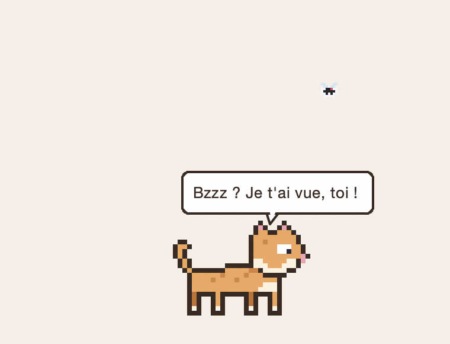
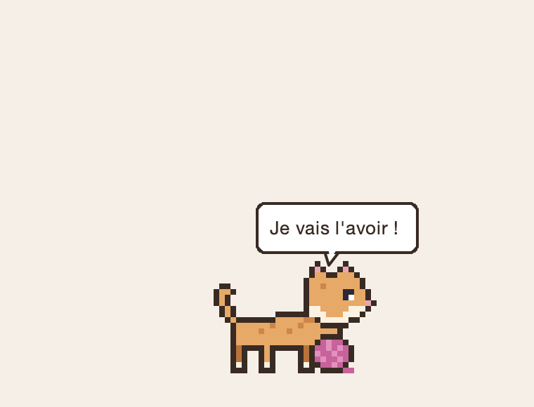
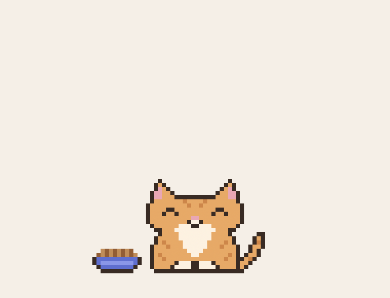
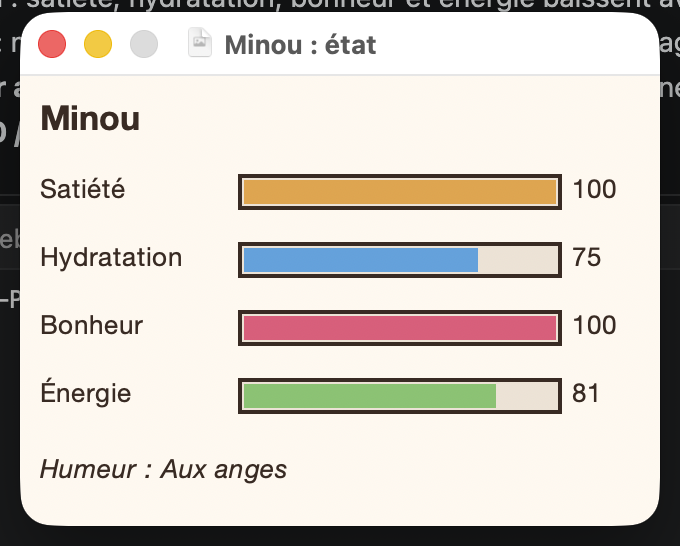
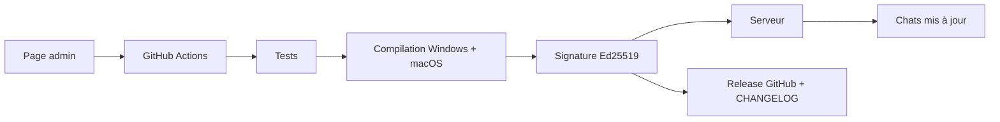

<div align="center">


# TamagoChat

**Un chat tamagotchi en pixel art qui vit sur votre bureau.**

[](https://github.com/Distrib-ps/TamagoChat/tags)


[](LICENSE)

[Installer](#installation) · [Utiliser](#utilisation) · [Développer](#développement) · [Publier](#publier-une-version) · [Serveur](#serveur-optionnel)

</div>

---

Minou se promène au-dessus de la barre des tâches (Windows) ou du Dock (macOS). On le caresse, on le
nourrit, il parle, chasse les mouches, fait sa toilette, s'étire, éternue, court après sa queue et pique
des crises de folie. Avec le serveur optionnel, on peut
aussi lui envoyer des messages et des bêtises à distance depuis une page web.

## Fonctionnalités

<table>
  <tr>
    <td width="33%" valign="top">
      <br>
      <b>Chasseur</b><br>
      <sub>Des mouches apparaissent de temps en temps : il les traque et bondit pour les gober.</sub>
    </td>
    <td width="33%" valign="top">
      <br>
      <b>Joueur</b><br>
      <sub>Pelote, crises de folie, grands sauts : il court partout, d'un écran à l'autre.</sub>
    </td>
    <td width="33%" valign="top">
      <br>
      <b>Câlin</b><br>
      <sub>Un clic pour le caresser ; il réagit, et finit par réclamer un peu d'espace.</sub>
    </td>
  </tr>
  <tr>
    <td width="33%" valign="top">
      <br>
      <b>Gourmand</b><br>
      <sub>Il faut le nourrir et lui donner à boire, sinon il le fait savoir.</sub>
    </td>
    <td width="33%" valign="top">
      <br>
      <b>Dormeur</b><br>
      <sub>Quand il est fatigué, il fait une sieste pour recharger son énergie.</sub>
    </td>
    <td width="33%" valign="top">
      <br>
      <b>Tamagotchi</b><br>
      <sub>Satiété, hydratation, bonheur et énergie baissent avec le temps. Il ne meurt jamais, il devient juste grognon.</sub>
    </td>
  </tr>
</table>

- **Bavard** : des phrases pour chaque situation (faim, sieste, matin…), toutes modifiables
- **À distance** : messages, soins, bêtises et réglages depuis une page admin protégée
- **Mises à jour automatiques et signées** : un chat n'installe qu'une version signée par votre clé
- **Windows 10 / 11 et macOS**, un ou plusieurs écrans

## Installation

Téléchargez la dernière version sur la page [Releases](https://github.com/Distrib-ps/TamagoChat/releases/latest).

| Système | Fichier | Installation |
|---|---|---|
| Windows | `TamagoChat-x.y.z.exe` | Lancer le fichier, rien à installer |
| macOS | `TamagoChat-x.y.z-mac.zip` | Décompresser, glisser `TamagoChat` dans **Applications**, puis la première fois : clic droit › **Ouvrir** |

Le chat se met ensuite à jour tout seul.

## Utilisation

| Action | Effet |
|---|---|
| Clic gauche | Caresser |
| Glisser | Déplacer (on peut le lancer, il retombe) |
| Clic droit (ctrl+clic sur Mac) | Menu : manger, boire, jouer, sieste, folie, mouches, réactions, état, renommer, phrases, options |
| Clic sur une mouche | L'écraser (il n'aime pas qu'on lui vole son goûter) |

Les options permettent de régler la promenade, la fréquence des phrases, le mode FOU, les mouches,
le premier plan, la taille et le lancement au démarrage.

La sauvegarde (`save.json`) et le journal d'erreurs (`erreurs.log`) se trouvent dans
`%APPDATA%\ChatTamagotchi` (Windows) ou `~/Library/Application Support/ChatTamagotchi` (macOS).

## Développement

Prérequis : Python 3.10+ de [python.org](https://www.python.org/downloads/), sans autre dépendance.

```bash
python3 chat.pyw       # macOS
python chat.pyw        # Windows (ou double-clic sur chat.pyw)

python -m unittest discover -s tests    # tests
```

> [!NOTE]
> Sur macOS, utilisez bien le Python de python.org : celui de Homebrew embarque Tk 9, qui n'affiche pas
> les fenêtres transparentes.

Sans `local_config.py`, le chat fonctionne entièrement hors ligne. Pour le relier à un serveur, copiez
`local_config.example.py` en `local_config.py` et remplissez-le.

<details>
<summary><b>Organisation du code</b></summary>

```
chat.pyw                 lanceur (Windows et macOS)
tamagochat/
├── app.py               fenêtre, boucle principale, souris, écrans, sauvegarde
├── behavior.py          comportement autonome : jauges, paroles, décisions, états
├── actions.py           soins, jeux et pouvoirs envoyés depuis la page admin
├── hunt.py, fly.py      chasse aux mouches
├── reactions.py         toilette, étirement, atchoum, course après sa queue
├── render.py            dessin en pixel art (sprites.py)
├── bubble.py            bulle de dialogue
├── menu.py, dialogs.py  menu du clic droit et fenêtres annexes
├── remote.py            lien avec le serveur et mises à jour signées
├── config.py            réglages, chemins
├── phrases.py           phrases par situation
├── storage.py           sauvegarde et journal d'erreurs
├── ed25519.py           signatures Ed25519 en Python pur
└── desktop/             tout ce qui dépend du système, même interface
    ├── windows.py
    └── macos.py
tests/                   tests unitaires
serveur/                 serveur aiohttp + SQLite, page admin, systemd, nginx
```

</details>

## Publier une version

Le bouton **Mises à jour** de la page admin (en haut à droite) affiche la version publiée, les changements pas encore déployés et le
numéro de la prochaine version, puis lance la publication en un clic. On peut aussi la lancer depuis
l'onglet *Actions* de GitHub (workflow « Publier une version »).

Le numéro est calculé par [semantic-release](https://semantic-release.org) à partir des messages de
commit ([Conventional Commits](https://www.conventionalcommits.org/fr/)) :

| Commit | Exemple | Version |
|---|---|---|
| `fix:` | `fix: le chat ne tombe plus de l'écran` | 1.1.2 → 1.1.3 |
| `feat:` | `feat: nouvelle bêtise « danse »` | 1.1.2 → 1.2.0 |
| `feat!:` | `feat!: nouveau format de sauvegarde` | 1.1.2 → 2.0.0 |
| `chore:`, `docs:`, `refactor:`… | `docs: corrige une faute` | aucune |



Compter environ 5 minutes ; les chats connectés se mettent à jour dans la minute qui suit.

## Serveur (optionnel)

Un petit serveur Linux (un VPS suffit, ~40 Mo de RAM) avec nginx apporte :

- **la page admin** `https://<serveur>/admin`, protégée par mot de passe : messages, soins, bêtises
  (folie XXL, nuée de mouches, grand saut, chute du ciel, changement d'écran, chasse à la souris,
  cache-cache), réactions (toilette, étirement, atchoum, course après sa queue), réglages, jauges,
  phrases et réponses des amis ;
- **la distribution des mises à jour**, toujours vérifiées par leur signature.

Chaque propriétaire garde la main dans les options de son chat (messages à distance, mises à jour
automatiques, réglages à distance) et peut répondre via clic droit › « Envoyer un message… ».

<details>
<summary><b>1. Créer la clé de signature</b></summary>

```bash
python3 -c "import secrets; from tamagochat import ed25519; s = secrets.token_bytes(32); print('SIGNING_KEY   =', s.hex()); print('UPDATE_PUBKEY =', ed25519.public_key(s).hex())"
```

Conservez `SIGNING_KEY` en lieu sûr : sans elle, impossible de publier une mise à jour.

> [!IMPORTANT]
> Une clé existe déjà (`~/.minou/signing.key`, dans le secret GitHub `SIGNING_KEY`) : ne la régénérez
> pas, les chats déjà installés ne font confiance qu'à elle.

</details>

<details>
<summary><b>2. Installer le serveur (Ubuntu / Debian)</b></summary>

Sans nom de domaine, [sslip.io](https://sslip.io) en fournit un à partir de l'IP : `1.2.3.4` → `1-2-3-4.sslip.io`.

Copiez le dossier `serveur/` sur la machine, placez-vous dedans, puis remplacez `MON-DOMAINE` et
`MOT-DE-PASSE` :

```bash
sudo apt install -y python3-venv nginx certbot
sudo useradd --system --home /opt/minou-server --shell /usr/sbin/nologin minou
sudo mkdir -p /opt/minou-server /var/www/minou-acme
sudo cp server.py admin.html requirements.txt ../tamagochat/ed25519.py /opt/minou-server/
sudo cp minou-server.service /etc/systemd/system/
sed 's/TON-DOMAINE/MON-DOMAINE/g' nginx-minou.conf | sudo tee /etc/nginx/sites-available/minou > /dev/null

cd /opt/minou-server
sudo python3 -m venv venv
sudo venv/bin/pip install -r requirements.txt
sudo chown -R minou:minou /opt/minou-server
sudo -u minou venv/bin/python server.py set-password 'MOT-DE-PASSE'

# service (écoute uniquement en local, sur 127.0.0.1:8090)
sudo systemctl daemon-reload && sudo systemctl enable --now minou-server

# nginx en HTTP, certificat Let's Encrypt, puis HTTPS
sudo ln -s /etc/nginx/sites-available/minou /etc/nginx/sites-enabled/minou
sudo nginx -t && sudo systemctl reload nginx
sudo certbot certonly --webroot -w /var/www/minou-acme -d MON-DOMAINE --deploy-hook "systemctl reload nginx"
sudo sed -i 's/^#SSL#//' /etc/nginx/sites-available/minou
sudo nginx -t && sudo systemctl reload nginx
```

La page `https://MON-DOMAINE/admin` est alors accessible. Les données sont dans
`/opt/minou-server/minou.db`. Relancer `set-password` change le mot de passe et déconnecte les sessions.

**Mise à jour du serveur** : recopier `server.py`, `admin.html` et `../tamagochat/ed25519.py` dans
`/opt/minou-server/` (ainsi que `nginx-minou.conf` s'il a changé), puis `sudo systemctl restart minou-server`.

</details>

<details>
<summary><b>3. Activer la publication depuis GitHub</b></summary>

GitHub n'a aucun accès SSH au serveur : il envoie chaque version à `/api/release` avec un jeton dédié,
et le serveur revérifie la signature avant de la publier.

1. Sur le serveur, activer le déploiement (la commande affiche un jeton) :
   ```bash
   cd /opt/minou-server && sudo -u minou venv/bin/python server.py setup-deploy PROPRIETAIRE/DEPOT CLE_PUBLIQUE
   ```
2. Dans le dépôt GitHub, *Settings › Environments*, créer l'environnement `release` et limiter ses
   *Deployment branches* à `main` (un workflow lancé depuis une autre branche n'aura pas les secrets).
   Y ajouter les secrets, et la variable dans *Settings › Secrets and variables › Actions* :

   | Type | Nom | Valeur |
   |---|---|---|
   | Secret (environnement `release`) | `SIGNING_KEY` | la clé privée (étape 1) |
   | Secret (environnement `release`) | `SERVER_URL` | ex. `https://1-2-3-4.sslip.io` |
   | Secret (environnement `release`) | `DEPLOY_TOKEN` | le jeton affiché ci-dessus |
   | Variable (dépôt) | `UPDATE_PUBKEY` | la clé publique (étape 1) |

3. Créer un token GitHub *fine-grained* limité au dépôt (Actions : lecture/écriture, Contents : lecture)
   et le coller dans la fenêtre **Mises à jour** de la page admin.

> [!WARNING]
> La clé de signature est stockée dans les secrets GitHub : protégez le compte propriétaire du dépôt
> (double authentification), car il permet de publier une mise à jour. Protégez aussi `main`
> (modifications par pull request validée) : quiconque peut y modifier le workflow peut utiliser la clé.

semantic-release commite le numéro de version et le `CHANGELOG.md` sur `main`. Si `main` est protégée,
il pousse avec une clé de déploiement (secret `RELEASE_DEPLOY_KEY` de l'environnement `release`,
clé ajoutée au dépôt avec droit d'écriture) autorisée à contourner la règle de protection.

</details>

## Licence

Distribué sous licence MIT. Voir [LICENSE](LICENSE).
